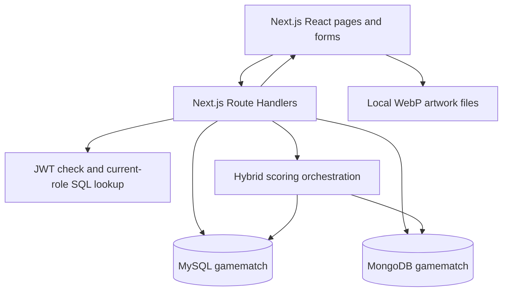

# GameMatch — implementation, database design and requirements guide

Prepared: **5 November 2026**. Recommendation refresh behavior updated **6 November 2026**. Implementation baseline: commit `3992b51` and the current checked-out source. This guide covers the actual implementation and all 18 sections of **DBMS Level 3 Project Requirements draft.pdf**. Rationale explains why the choices fit this project; it does not imply that alternatives were experimentally benchmarked.

This is a source-based reference. Database contents can change independently of Git. Historical checks below are not a fresh live-database audit. The supplied PDF is a requirements source, not an instruction to reset databases.

## 1. Problem, objectives and scope

**Title:** GameMatch — Explainable Game Recommendation Platform.

**Problem:** A large catalog is difficult to explore using popularity or title search alone. Users have different tastes. The application combines personal genre preferences, ratings from similar players and recent play activity, and explains why a game was recommended.

**Objectives and functional requirements:**

- Browse/search games and filter by genre, platform and maximum price.
- Register/login, write/edit/delete ratings and reviews, maintain a wishlist and buy into a simulated library.
- Recommend active games the user has neither rated nor purchased, with a visible score breakdown.
- Let administrators manage catalog data, add genres/platforms, inspect analytics and recompute recommendations.
- Demonstrate SQL design, constraints, joins, routines, views, triggers and transactions alongside MongoDB modeling, validation, text search and aggregation.

Visitors can browse. The two stored roles are `player` and `admin`; protected personal workflows require a signed-in account, while management requires admin. A visitor is an access state, not a third stored role.

This is an educational recommendation system and simulated store. It does not process real payments, launch/install games, automatically measure device playtime or deliver commercial game entitlements. The shipped manifest contains 64 games, not a guarantee of the current live count. New games have no invented reviews or play sessions.

## 2. Architecture and implementation decisions



The browser calls APIs using `fetch` through `lib/client.js`. Route Handlers validate inputs, authorize actions and call server-side database drivers. The backend merges SQL and Mongo results by numeric `game_id`; there is no database-native cross-store JOIN. Credentials stay on the server.

| Choice | Why used here | Alternatives and trade-offs |
|---|---|---|
| Next.js App Router, React and JavaScript | Required web framework; pages and APIs share one project/deployment; JavaScript matches the implemented codebase | Separate Express backend adds deployment complexity; TypeScript could improve static checking but is not used |
| MySQL | Accounts, ratings, relationships and purchases need keys, constraints, joins and transactions; SQL objects expose DBMS concepts | PostgreSQL could also meet these needs; no claim that MySQL is universally superior |
| MongoDB | Nested requirements vary by platform; tags/screenshots/DLC are arrays; sessions support a time-window aggregation | SQL JSON/child tables are possible; using Mongo creates meaningful second-paradigm work but adds consistency complexity |
| No vector database | Current recommendations use explicit genres and rating similarities; keyword retrieval meets the implemented search scope | Embeddings require a model, vector store, update pipeline and evaluation; none is implemented |
| Native mysql2/promise and mongodb drivers | Keeps parameterized SQL, stored routines and pipelines explicit for demonstration | An ORM could reduce CRUD code but would not replace the advanced SQL or solve cross-store transactions |
| Stored SQL scoring/purchase logic | Reusable calculations and transactional rules execute near relational data | All-JavaScript calculations would obscure database-side objectives; routines require deployment/versioning care |
| Stored avg_rating maintained by triggers | Avoids aggregating every catalog card on every read | Read-time AVG avoids redundant storage; chosen approach is deliberate denormalization with maintenance obligations |
| Persisted Recommends components | Fast ranked reads and transparent explanations | Recomputed on every user request for freshness; more database work than serving cached scores |
| Soft deletion with is_active | Preserves stored ratings/purchase history | Hard deletion would cascade history and require Mongo cleanup; current user-facing library also hides inactive games |
| Shared SQL numeric IDs | SQL owns identity; Mongo game_id identifies the same game | Copying Mongo _id into SQL adds coupling without enforcing cross-store integrity; mongo_metadata_id is absent |
| Local WebP art and Next.js Image | Shipped images do not depend on external CDN availability on every visit; responsive/lazy loading reduces transfer | Hotlinks simplify storage but add external runtime dependencies; local assets increase repo size |
| Bcrypt and signed cookie JWT | Hashes passwords and supports authenticated API calls; current roles are re-read from SQL | Server sessions make centralized revocation easier; cookie logout is not token revocation |

The neutral palette uses `#D1D0D0`, `#988686`, `#5C4E4E` and black for background, supporting surfaces and action emphasis. The 60/30/10 rule is a design intention, not a measured pixel-area invariant. The focus remains recommendations rather than animations.

## 3. MySQL model and data dictionary

Sources: [01_schema.sql](../database/mysql/01_schema.sql), [02_features.sql](../database/mysql/02_features.sql), [DATABASE_MODEL.md](DATABASE_MODEL.md).

There are **10 base tables, 41 columns and 12 foreign keys**. The linked model reference provides exact types, defaults, nullability and constraints.

| Table | Attributes | Keys and purpose |
|---|---|---|
| User | user_id, username, email, password_hash, role, created_at | PK user_id; unique username/email; identity and current authorization role |
| Game | game_id, title, publisher, base_price, avg_rating, release_date, is_active | PK game_id; structured catalog |
| Genre | genre_id, name | PK genre_id; unique vocabulary name |
| Platform | platform_id, name | PK platform_id; unique vocabulary name |
| HasGenre | game_id, genre_id | Composite PK; both FKs; game–genre M:N |
| OnPlatform | game_id, platform_id | Composite PK; both FKs; game–platform M:N |
| Rates | user_id, game_id, score, review_text, rated_at | Composite PK; both FKs; one rating per user/game |
| Adds | user_id, game_id, added_at | Composite PK; both FKs; wishlist membership |
| Owns | user_id, game_id, price_paid, purchased_at | Composite PK; both FKs; library and historical paid price |
| Recommends | user_id, game_id, method, score, content_score, collab_score, trending_score, generated_at | Composite PK; both FKs; one latest result per user/game, not one per method |

All relationship IDs are NOT NULL and FKs use ON DELETE CASCADE. Each entity may have zero or many relationship rows; each junction row references exactly one existing parent on each side. The DDL does not require every game to have a genre/platform.

Separate junction tables avoid comma-separated/repeated genre/platform columns. Rates, Adds and Owns represent different facts. Entity attributes depend on their entity key; relationship attributes depend on the full composite key. This is a normalized relational organization with explicit derived storage for avg_rating and materialized recommendation results. An ER drawing alone is not a formal normal-form proof.

Monetary values use DECIMAL. `price_paid` retains purchase-time value when `base_price` changes. Ratings are integer 1–5; Game.avg_rating permits 0–5, with 0 representing no ratings. Recommendation components and total are bounded 0–1. Publisher/release_date are nullable in base SQL. Username/email/name uniqueness is separate from primary-key identity.

The final [ER diagram](er-diagram.png) and [relational schema](relational-schema.png) include is_active, recommendation components and timestamps, and remove the obsolete mongo_metadata_id. Editable SVGs are alongside them. Optional ALTER changes in 04_queries.sql are intentionally excluded from the base diagrams.

## 4. MongoDB model, indexes and associations

Source: [database/mongodb/init.js](../database/mongodb/init.js).

| Collection | Fields | Database validation |
|---|---|---|
| game_metadata | _id; required game_id, description, tags; optional screenshots, system_requirements, dlc; optional extra catalog_source | game_id BSON int >=1; description string >=10 chars; tags/screenshots string arrays; requirements object; DLC array |
| activity_log | _id, user_id, game_id, session_start, playtime_minutes, device | All business fields required; IDs BSON int >=1; BSON date; integer minutes 1–1440; device PC/PlayStation/Xbox/Switch |

Requirements can be structured seed objects or Windows/Mac/Linux minimum/recommended strings from Steam. The UI displays JSON rather than assuming one universal shape. The API validates individual DLC names/prices more strictly than the collection validator, which only requires an array.

`catalog_source` records Steam app ID, URL, retrieval timestamp, artwork source and pricing/DLC notes. It is optional application provenance permitted by the validator, not a required SQL column.

| Index | Use |
|---|---|
| game_metadata unique {game_id:1} | Exact metadata lookup; at most one document per ID |
| game_metadata text on description/tags | Keyword search ordered by textScore |
| activity_log {session_start:-1, game_id:1} | Date-window trending access |
| activity_log {user_id:1, session_start:-1} | Available for user history; no history screen currently uses it |

SQL Game.game_id corresponds logically to metadata.game_id and session.game_id; SQL User.user_id corresponds to session.user_id. These are **application-maintained associations, not cross-database foreign keys**. Mongo cannot verify SQL parent existence. A unique index enforces at most one metadata document, not exactly one document for every SQL game. SQL cascades do not delete Mongo data. Admin/import writes use BSON Int32 to satisfy ID validation.

### Where the pictures live

Image bytes are files under `public/images/games/<steam-app-id>/`. Mongo screenshots stores URL strings: first is the cover, remaining entries form the gallery. SQL stores neither image bytes nor Mongo _id. `lib/game-media.js` attaches cover_image to catalog/recommendation rows using one batched metadata query. `GameArtwork` renders Next.js Image with a text fallback for missing/broken art; custom admin games can still lack images.

## 5. Which application feature uses which database?

| Screen/action and API | MySQL read/write | MongoDB/files use |
|---|---|---|
| Register: POST /api/auth/register | Insert User with bcrypt hash and player role | None |
| Login/current user: /api/auth/login, /api/auth/me | Read account/hash or current role | None |
| Catalog: GET /api/games | Game, genre links/names, platform filters, active/price filters and title matches | Metadata text search and batched cover paths; local image files |
| Options: /api/genres, /api/platforms | GET vocabulary; admin POST inserts vocabulary | None |
| Detail: GET /api/games/[id] | Game, genre/platform joins, Rates JOIN User reviews; own rating/ownership/wishlist state | findOne metadata by game_id; description, tags, requirements, DLC, art |
| Rating: POST/PUT/DELETE /api/ratings | Insert/edit/delete Rates; trigger updates Game.avg_rating | None; does not create a play session |
| Wishlist: GET/POST/DELETE /api/wishlist | Adds JOIN Game for read; insert/delete membership | No Mongo query in this route |
| Purchase: POST /api/purchase | CALL sp_purchase_game; Owns insert and Adds delete | None |
| Library: GET /api/library | vw_user_library JOIN Game, current-user/active filters | No Mongo query in this route |
| For You: GET /api/recommendations | Read Recommends JOIN Game; filter rated/owned/inactive; compute if no results | Cover paths; activity aggregation when computing |
| Admin game POST/PUT | Game and HasGenre/OnPlatform writes | Metadata insert/replace, provenance preservation |
| Admin game DELETE | UPDATE Game SET is_active=FALSE | Metadata retained |
| Analytics: GET /api/admin/analytics | Top-rated genre view; reviewer counts; active title map | Trending session aggregation |
| Admin recompute: POST /api/recommendations/recompute | SQL scoring and replacement Recommends | One shared trending aggregation per batch |
| npm run seed:catalog | Insert new catalog/link/vocabulary records; preserve existing SQL; refresh recommendations | Metadata/art provenance upsert; shipped local images |

### Catalog read/search flow

1. Browser submits optional q, genre, platform and maxPrice.
2. API validates IDs, numeric limits and search length.
3. For q, parameterized MySQL LIKE finds title substrings, escaping literal wildcard characters. Mongo `$text` finds description/tag matches ordered by textScore.
4. Backend merges IDs with title matches first, removing overlaps with metadata matches.
5. SQL applies active/price/genre/platform filters. EXISTS and JSON_TABLE support filtering without unsafe ID interpolation.
6. Genre names and batched cover paths are attached. Search order is restored; without q, order is average rating descending then title.

The live SQL title path uses **LIKE**, not MATCH AGAINST. A MySQL FULLTEXT index and a MATCH demo exist separately. Mongo text search is keyword search, not embeddings or semantic retrieval.

### Rating flow

Server obtains user_id from the authenticated account, validates an active game and score, and writes Rates with bound values. Composite PK prevents duplicate POST ratings. PUT changes rating/review/timestamp; DELETE removes that user's row. Three AFTER triggers recompute AVG(score) for the affected game, falling back to zero. Detail data is re-fetched for display. The next recommendation request recomputes using current ratings; the open For You page refreshes every minute and on focus/visibility return.

### Purchase flow

The API validates authentication and an active game. `sp_purchase_game` starts a transaction, reads the price FOR UPDATE, inserts Owns with that price and deletes the user's Adds row. COMMIT makes both changes durable together. Its exception handler ROLLBACKs and RESIGNALs. Duplicate ownership maps to HTTP 409. There is no Mongo write or real payment in this transaction.

### Admin save and cross-database failures

`lib/admin-games.js` validates the payload, begins SQL transaction, locks an existing Game for editing, writes Game and replaces genre/platform links, then inserts/replaces Mongo metadata with the SQL ID. Existing Steam provenance is preserved. SQL commits after Mongo succeeds.

Mongo failure rolls back SQL. SQL commit failure after Mongo success triggers an attempt to restore previous metadata or remove the new document. This is **best-effort compensation, not a guaranteed distributed transaction**. Crash/compensation failure can leave inconsistent stores; reconciliation is future work.

DELETE means deactivate. Ratings, purchases and metadata remain stored, although ordinary catalog/detail/recommendation/wishlist/library queries hide inactive games. Admin save does not currently expose reactivation.

## 6. Recommendation algorithm and actual inputs

| Input | Effect today |
|---|---|
| User ratings | Genre preference and collaborative similarity |
| Ownership | Excludes purchased games |
| Mongo play sessions | Global seven-day trending |
| Wishlist | Saved interest only; not scored |
| Page visits, clicks, search history | Not captured as scoring inputs |
| Description/tags | Display/search; not fn_content_score inputs |

The website does not automatically record real playtime. activity_log comes from the seed script or an external/manual validated producer; there is no play-session ingestion API. More games do not create authentic interactions automatically.

### Candidates and transaction

Select active games neither rated nor owned. Lock the User row FOR UPDATE to serialize simultaneous recomputations for that user. Calculate positive-score candidates; delete old Recommends and insert replacements in one SQL transaction. On error roll back.

### Content score — 30%

`fn_content_score(user, game)` finds the user's average rating for each genre using Rates JOIN HasGenre. Unknown genres get zero. Average these preferences across the candidate's genres and divide by five.

```text
content = mean(user genre preferences for candidate genres, missing=0) / 5
```

For RPG preference 5 and Simulation preference 0, a candidate in both receives `(5+0)/2/5=0.5`. This uses explicit genres, not text similarity, tags or overall game popularity.

### Collaborative score — 50%

`sp_collaborative_scores(user)` finds neighbours with at least two commonly rated games. Pearson-style similarity uses deviations from each user's mean over **all their ratings**, rather than the variant centred only on common items. Zero denominators yield NULL; only positive similarities contribute.

```text
collaborative = sum(similarity * neighbour_rating) / sum(similarity) / 5
```

No eligible neighbours means zero. This uses CTEs, joins, GROUP BY, HAVING, aggregate arithmetic and exclusion subqueries. It is an interpretable rating prediction, not a trained neural model or measured accuracy claim.

### Trending score — 20%

Mongo pipeline matches session_start >= now minus seven days; groups by game; sums playtime; counts sessions/distinct players; finds maximum total; divides each game total by maximum; rounds to four decimals; sorts descending.

```text
trending(game) = game playtime within window / maximum game playtime within window
```

An empty window produces no rows; missing scores become zero. This is global popularity, not personal session similarity. Seed sessions expire naturally; there is no automatic ingestion or scheduled refresh. The current filter supplies a lower date bound, not a separate upper bound for future-dated sessions.

### Hybrid, persistence, explanation and freshness

```text
hybrid = round(0.30*content + 0.50*collaborative + 0.20*trending, 4)
```

Weights are fixed design choices, not tuned against a benchmark. Missing components stay zero without renormalization; zero totals are omitted. Cold-start users can get trending-only scores up to 0.2. With no ratings and no recent sessions, no positive recommendations may exist. New games can get genre matches without ratings.

Recommends stores total and all components with method='hybrid'. The explanation selects the largest **weighted contribution**, not the largest raw component. A displayed match percentage is a scaled score, not a probability of enjoyment.

GET recommendations always recomputes for the authenticated user before reading and returns private, no-store responses. The For You page refreshes on opening, every 60 seconds while visible, and on focus/visibility return; overlapping requests are suppressed. Changes to ratings (including other players), ownership, catalog and recent session activity are picked up on the next refresh without admin intervention. Admin batch recomputation remains optional. This is request-time computation and browser polling, not server push or a background scheduler.

The four-game example `0.7700` and `0.1800` needs matching base seed, eligible candidates and recent sessions. Expanded catalogs/ownership/time changes alter results; do not reset real ownership just to force that example.

## 7. SQL and advanced database feature evidence

| Concept | Concrete implementation and use |
|---|---|
| CREATE | 01 tables/indexes; 02 views/routines/triggers |
| ALTER | Optional last_login and publisher widening in 04; demonstration only, not live login tracking |
| DROP | Database reset in 01; scratch table/view demo in 04 |
| INSERT | Registration, rating, wishlist, purchase, admin game and recommendation writes |
| UPDATE | Rating/game edits, soft deletion and trigger-maintained averages |
| DELETE | Rating/wishlist removal, relationship replacement, recommendation replacement; meaningful despite soft Game deletion |
| SELECT/JOIN | Review/user joins, library view, catalog relationships |
| GROUP BY/HAVING/aggregates | Neighbour routine and genre-statistics demo |
| ORDER BY/subqueries | Ranking, EXISTS exclusions and preference means |
| Transactions | Purchase, recompute and admin SQL writes |
| Views | vw_top_rated_by_genre for analytics; vw_user_library for library |
| Stored routines | fn_content_score, sp_collaborative_scores, sp_purchase_game |
| Triggers | Rates AFTER INSERT/UPDATE/DELETE maintain Game.avg_rating |
| Indexes | PK/UNIQUE; idx_rates_game, idx_hasgenre_genre, idx_game_release; title FULLTEXT |
| Full-text | Mongo description/tag search in live catalog; MySQL MATCH example separately |
| NoSQL aggregation | Session trending and analytics |

Transactions, views, routines, triggers, indexing, full-text and NoSQL aggregation exceed the required four categories even if procedures/functions count together. Index existence is not a measured performance claim; EXPLAIN and benchmarks would supply that evidence.

### Important query examples

```sql
SELECT game_id, title, fn_content_score(1, game_id) AS content_score
FROM Game WHERE is_active=TRUE ORDER BY content_score DESC;
CALL sp_collaborative_scores(1);
SELECT * FROM vw_user_library WHERE user_id=1;

SELECT ge.name, COUNT(DISTINCT g.game_id) AS games,
       ROUND(AVG(r.score),2) AS avg_score, COUNT(r.score) AS ratings
FROM Genre ge JOIN HasGenre hg ON hg.genre_id=ge.genre_id
JOIN Game g ON g.game_id=hg.game_id
LEFT JOIN Rates r ON r.game_id=g.game_id
GROUP BY ge.name HAVING COUNT(r.score)>=2
ORDER BY avg_score DESC;
-- Purchase mutates data; use an appropriate disposable user and game:
-- CALL sp_purchase_game(<demo_user_id>, <demo_game_id>);
```

```javascript
// mongosh; game ID must correspond to an SQL game.
db.game_metadata.findOne({game_id:NumberInt(1)});
db.game_metadata.find(
  {$text:{$search:'pixel-art story'}},
  {_id:0,game_id:1,score:{$meta:'textScore'}}
).sort({score:{$meta:'textScore'}});
// Full trending pipeline: lib/recommend.js and database/mongodb/init.js.
```

[04_queries.sql](../database/mysql/04_queries.sql) is a mutating, non-idempotent classroom demo, not normal app setup. Its optional ALTERs change the base model. Its manually inserted recommendation examples do not populate components like the actual application does. Do not run it indiscriminately on valuable/expanded data.

## 8. Validation, security and integrity

- SQL PK/FK/UNIQUE/NOT NULL/CHECK constraints enforce identity, relationships and value ranges. Email CHECK is a simple pattern, not verification of deliverability.
- Mongo JSON Schema enforces required fields/types/playtime/device; metadata unique index prevents duplicate game IDs. It cannot validate SQL parent existence.
- API validation covers IDs, malformed JSON, field lengths, numeric ranges, valid dates and metadata shape. Admin DLC validation exceeds collection-level array validation.
- SQL execute calls bind parameters; server code controls query structure. LIKE escaping handles literal wildcards.
- Passwords are bcrypt hashes at cost 10. Login compares hashes; raw passwords are not stored in User or returned to clients.
- JWTs use HS256 and seven-day expiration, with validated subject/role. Cookies are HttpOnly, SameSite=Lax and Secure in production. Production authentication requires HTTPS; use dev mode for local HTTP.
- API authorization reads current account/role from SQL, so stale token roles alone do not grant admin. proxy.js protects pages; API handlers enforce access independently.
- MYSQL_URL, MONGODB_URI and JWT_SECRET are server environment values; .env.local is ignored. Local plaintext configuration is not a secret manager; production should inject secrets securely.
- Generic errors avoid returning raw database internals. No dedicated login rate limiting, MFA, password recovery or centralized JWT revocation is implemented.
- SQL transactions do not span MongoDB. Cascades do not cross databases. MySQL FK cascades do not fire child-table triggers: direct maintenance must account for derived averages. Integration cleanup explicitly removes temporary ratings before deleting a user.

## 9. Dataset, sourcing and setup

The shipped `data/catalog.json` contains 64 source-backed games. `scripts/fetch-catalog.mjs` reads public Steam US/English store details, downloads covers/screenshots and converts WebP. There are **192 local images**, one cover plus two screenshots per game. Dates use explicit UTC parsing to avoid day shifts. Prices are base USD snapshots, not live prices.

`npm run seed:catalog` validates manifest/assets, takes a SQL advisory lock, identifies imported records by Steam provenance/original titles, and writes new SQL records/links plus Mongo metadata. Existing SQL fields/relationships and metadata descriptions/tags/requirements/DLC are preserved; art/provenance refresh. It fingerprints account identifiers/roles and Rates/Owns/Adds to check preservation, handles per-game transaction/compensation and refreshes recommendations. Completed games remain after a later failure; reruns resume without intended duplication.

New imports are PC-linked because Steam does not establish console availability. Existing platforms remain. New DLC lists are empty rather than invented; existing DLC stays. No fake reviews or sessions are created. Artwork belongs to the respective rights holders and is attributed in provenance/detail links. See [CATALOG_DATA.md](CATALOG_DATA.md) for source/cache/refresh limits.

### Setup

Prerequisites: Node >=20.19, npm, MySQL >=8.0.16, MongoDB >=6, mysql and mongosh clients. Dependencies/versions: package.json and package-lock.json.

1. Run npm install.
2. On new/disposable databases only, load MySQL 01_schema.sql → 02_features.sql → 03_seed.sql and Mongo init.js. These initialization scripts DROP existing databases/collections.
3. Copy .env.example to .env.local; set MYSQL_URL, MONGODB_URI and a randomly generated JWT_SECRET. Include database name and URL-encode password punctuation.
4. On seed accounts only, run npm run seed:passwords. It resets every user's password, not merely new accounts.
5. Run npm run seed:catalog for the non-destructive expansion.
6. Run npm run dev for local HTTP, or npm run build then npm start with production HTTPS.

Exact commands: [README.md](../README.md). Seed u1_arjun/admin use password123 only after the seed-password script; that is a demo configuration. It is not plaintext password storage in SQL. Never reset valuable user passwords or data merely for a demo.

## 10. Testing, screenshots and demonstration

The offline suite now has 14 tests, including request-time recommendation refresh and authorization regressions, covering token/password/cookie behavior, validation/error mapping, current-role checks, admin compensation, recommendation orchestration and media enrichment. Test doubles do not prove live SQL triggers or Mongo validators execute correctly.

**Current documentation-session verification (5 November 2026):** `npm test` passed all 12 tests with zero failures. Live services, lint and production compilation were not rerun for this documentation-only change.

Historical 31 October checks reported: all 64 live detail records and cover images, three title searches, mobile layouts, and 46 recommendation cards with artwork for an existing account. Import added 60 games and preserved interaction fingerprints; repeat import created zero. Tests/lint/build passed that session. These are historical results, not a fresh 5 November live audit. Earlier PROJECT_SPEC/README notes describing 10 tests and deferred live checks reflect an older stage.

```bash
npm test
npm run lint
npm run build
# Mutating live suite: disposable fresh four-game seed only.
npm run test:integration -- --confirm-demo-db
```

The integration runner deliberately rejects an expanded catalog. T1–T11 cover invalid/duplicate ratings, trigger averages, purchase/wishlist atomicity, duplicate/nonexistent purchases, Mongo negative-playtime rejection, role denial, seed scoring, text search and protected-page redirect. Current handlers can reject an unknown game before the stored procedure runs. A test runner's existence is not evidence that every test passed.

### Screenshot artifacts

[Catalog](screenshots/catalog.png), [detail](screenshots/game-detail.png), [recommendations](screenshots/recommendations.png), [login](screenshots/login.png), [registration](screenshots/register.png), [wishlist](screenshots/wishlist.png), [library](screenshots/library.png), [admin catalog](screenshots/admin-games.png), [analytics](screenshots/admin-analytics.png), [mobile](screenshots/catalog-mobile.png).

These committed images are labeled fixture previews from the older stage, not evidence of the expanded live catalog. Later captures in ignored output/playwright are local artifacts, not portable Git deliverables. Capture fresh live screenshots for final submission and label evidence accurately.

### Final demo sequence

1. Explain problem, roles, objectives and educational scope.
2. Present ER/schema, composite PKs, FKs, optional M:N participation and constraints.
3. Show Mongo documents/validators/indexes and shared IDs.
4. Browse/filter/search, open detail/art and explain the two-store merge.
5. On disposable data, add/edit/delete a rating and observe its trigger-maintained average.
6. Wishlist then buy; show Owns insertion, Adds deletion and duplicate-purchase failure.
7. Recompute; inspect persisted components, weighted explanation and exclusions.
8. Demonstrate view-backed analytics and session trending/expiry.
9. Show role denial and invalid-data rejection; explain test evidence.
10. Present genuine contributions, originality evidence, limitations and future work.

## 11. All 18 requirements from the PDF

Source: supplied four-page DBMS Level 3 Project Requirements draft.pdf; [repository requirements copy](requirements.pdf). Status describes implementation evidence, not an instructor's final grade.

| PDF requirement | Project answer/evidence | Qualification or gap |
|---|---|---|
| 1. Unique title, meaningful problem, not simple CRUD | GameMatch; personalized ranking/explanations, transactional purchase and analytics | Section-wide title uniqueness requires instructor/section confirmation |
| 2. Approved two-member team, both DB and app contributions | Named team and documented allocation below | Approval and authentic individual contribution need human/Git evidence; allocation alone is not proof |
| 3. Minimum two database paradigms | MySQL relational and MongoDB documents; rationale in sections 2–4 | Item 3's list is ambiguous, but item 8 explicitly makes vector optional; disclose no vector DB and confirm if instructor interprets differently |
| 4. ER to relational schema; attributes/keys/constraints; NoSQL model/index/retrieval | Digital diagrams, dictionary, Mongo model and access flows | Cross-store IDs are logical associations, not FKs; no embeddings applicable |
| 5. DDL CREATE/ALTER/DROP, keys/constraints/indexes/views | 01 schema, 02 features, optional 04 demonstrations | Scripts present; not a fresh execution claim. Optional ALTER model excluded from base diagrams |
| 6. Meaningful INSERT/UPDATE/DELETE/SELECT and complex queries | Sections 5 and 7; joins, grouping, HAVING, aggregates and subqueries | Live app paths distinguished from classroom-only examples |
| 7. At least four advanced concepts | Transactions, views, routines, triggers, indexing, full-text, aggregation | Exceeds minimum; actual execution should be demonstrated |
| 8. Optional semantic/vector retrieval | No embeddings/model/vector storage/vector metric | Optional feature absent; keyword search and rating correlation are not vector-database search |
| 9. Functional Next.js UI | Forms, catalog/filter/search, details, wishlist/library, recommendation and admin screens | Running demonstration depends on configured services |
| 10. Backend integration; environment configuration | Next.js Route Handlers, native drivers and server env clients | No browser database connection or intended committed real secrets |
| 11. Authentication and minimum two roles | Bcrypt, JWT, current-role lookup, player/admin | Visitor is not a third stored role |
| 12. Database validation and integrity | SQL constraints/transactions/triggers; Mongo validators/index; compensation | No guaranteed cross-store atomicity or FK enforcement |
| 13. Basic web/database security; no plaintext password/credentials in source | Hashing, bound queries, authorization, ignored local credentials and cookie flags | Production hardening/security audit remain; local env is not encrypted secret storage |
| 14. Full documentation | This guide plus model, diagrams, source, queries, screenshots and tests | Historical/fixture evidence labeled; fresh live evidence still needs collection |
| 15. Git/GitHub, individual contributions, README | Published source baseline 3992b51 and setup README | Authentic per-member history needs separate review |
| 16. Final demonstration of problem/design/implementation/UI/features/tests/contributions | Section 10 demo sequence | Document cannot prove actual presentation or member understanding |
| 17. Original design, no copied project | Specific design/pipeline can be explained from source; external data/art attributed | Originality cannot be certified from code alone; disclose assistance as course rules require |
| 18. Beyond CRUD and justified paradigms | UI invokes SQL routines/views/triggers and Mongo metadata/aggregation | Strong design-to-application connection; no fabricated telemetry/accuracy/semantic-search claims |

### Requirement 14 locator

| Required documentation topic | Location |
|---|---|
| Problem, objectives, scope, functional requirements | Section 1 and feature map in section 5 |
| ER diagram and relational schema | Section 3 links; DATABASE_MODEL.md |
| Database choices and dictionary | Sections 2–4 |
| SQL/NoSQL/vector implementation | Sections 3–8; vector explicitly absent |
| Important queries and architecture | Sections 2 and 7 |
| Application screenshots and testing | Section 10 with provenance/limits |
| Conclusion and future enhancements | Section 12 |

## 12. Team, known gaps and conclusion

Team 15, Section H:

| Member | SRN | Documented allocation, not verified authorship |
|---|---|---|
| Sharat Doddihal | PES1UG24CS430 | MySQL schema/triggers/routines/purchase; catalog and library pages |
| Shashannk Palcharla | PES1UG24CS436 | Mongo validators/aggregation/search; recommendation API and dashboard |

PROJECT_SPEC records this split and shared app/scoring work, with an older spelling of Shashannk's name. The README/current identity above is used here. Both members should explain database and application work. Recent inspected commits are authored by Shashannk; this neither proves the other member did no work nor establishes two-person Git contributions. Obtain genuine evidence and approval; do not fabricate commits or rewrite authorship.

| Limit | Future enhancement |
|---|---|
| No automatic play-session capture | Authenticated telemetry ingestion from a suitable producer with validation/privacy policy |
| Request-time computation adds database work | At larger scale, use reliable invalidation and incremental/background computation |
| Sparse ratings, fixed weights and no quality benchmark | Collect authentic interactions; evaluate held-out ranking quality and tune weights |
| No semantic discovery | Optional embedding/vector pipeline with model, metric and evaluation |
| Best-effort two-store compensation | Durable operation tracking and reconciliation/failure recovery |
| Inactive titles hidden in library, no reactivation handler | Decide unavailable-purchase visibility and add restoration workflow |
| PC-only imports and incomplete DLC | Verify broader platform/DLC sources; absence is not evidence a feature does not exist |
| Seed activity expires, no scheduler | Real ingestion and periodic recomputation rather than destructive reseeding |
| No measured scale/performance evidence | EXPLAIN, load tests, pagination/batching and indexing evaluation |
| Basic auth scope | Rate limiting, account recovery/revocation and managed deployment secrets |
| Older fixture screenshots/test notes | Current live screenshots and disposable-database integration evidence |
| Contributions/originality not proven by code | Genuine records, instructor approval and required disclosures |

**Conclusion:** GameMatch puts structured relationships and atomic purchases in MySQL, flexible descriptions and session aggregation in MongoDB, and exposes both through Next.js. Its Level 3 value is the integrated content function, collaborative procedure, purchase transaction, rating triggers, views and trending pipeline. Present it as an explainable educational system with seeded activity and explicit limits, rather than a production store or accuracy-validated recommendation service.

## Source map

- [README](../README.md), [older specification](PROJECT_SPEC.md), [model dictionary](DATABASE_MODEL.md), [catalog sourcing](CATALOG_DATA.md).
- [MySQL schema](../database/mysql/01_schema.sql), [features](../database/mysql/02_features.sql), [seed](../database/mysql/03_seed.sql), [demo queries](../database/mysql/04_queries.sql), [Mongo initialization](../database/mongodb/init.js).
- [Recommendation logic](../lib/recommend.js), [admin compensation](../lib/admin-games.js), [artwork enrichment](../lib/game-media.js), [authentication](../lib/auth.js), [tokens](../lib/token.js), [validation](../lib/api.js).
- [Catalog API](../app/api/games/route.js), [ratings](../app/api/ratings/route.js), [purchases](../app/api/purchase/route.js), [recommendations](../app/api/recommendations/route.js), [analytics](../app/api/admin/analytics/route.js).
- [Importer](../scripts/seed-catalog.mjs), [source fetcher](../scripts/fetch-catalog.mjs), [integration runner](../scripts/test-integration.mjs), [application tests](../tests/application.test.mjs), [media tests](../tests/game-media.test.mjs).
