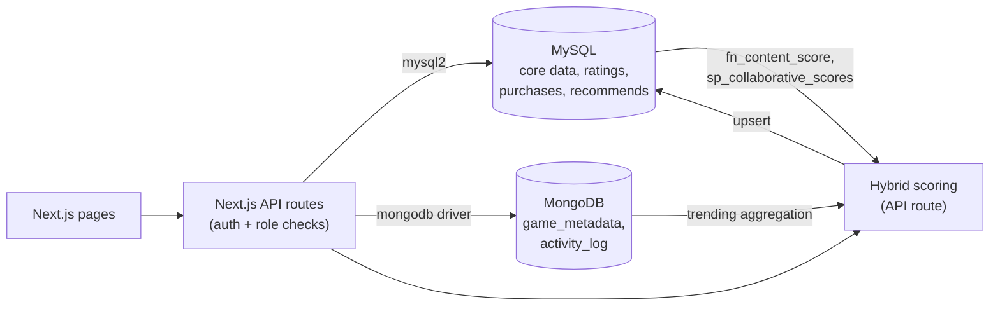

# GameMatch — Explainable Game Recommendation Platform

DBMS Experiential Learning, Level 3 Project · Section H · Team 15

| Member | SRN | Owns |
|---|---|---|
| Sharat Doddihal | PES1UG24CS430 | MySQL schema, triggers, stored function/procedures, purchase transaction; catalog + library pages |
| Shashank Palcharla | PES1UG24CS436 | MongoDB collections, validators, aggregation, text search; recommendation API + dashboard page |

Both members work on the Next.js app and the hybrid scoring route, so each touches database **and** application code (requirement 2).

---

## 1. Problem Statement

Game stores have tens of thousands of titles, and their recommendations are a black box — players can't see *why* a game was suggested. GameMatch recommends games with a score the player can inspect, built from three signals:

| Signal | Meaning | Computed in |
|---|---|---|
| Content | "You rate games in this game's genres highly" | MySQL stored function |
| Collaborative | "Players who rate like you loved this" | MySQL stored procedure |
| Trending | "People are playing this a lot this week" | MongoDB aggregation |

`hybrid = 0.3 × content + 0.5 × collaborative + 0.2 × trending` (each part in 0–1).

The project goes beyond CRUD: the core is a scoring pipeline that spans two databases, plus a transactional purchase flow and trigger-maintained ratings.

## 2. Objectives

1. Store entities with fixed structure and strict relationships (users, games, ratings, purchases) in MySQL with integrity enforced by the database.
2. Store variable-shape metadata and high-volume play activity in MongoDB.
3. Compute an explainable hybrid recommendation from both databases.
4. Provide a Next.js web app with two roles (player, admin).

## 3. Scope

**In scope:** catalog browse/search/filter, ratings & reviews, wishlist, mock purchase into a library, recommendations with score breakdown, admin game management, admin analytics.

**Out of scope:** real payments, vector embeddings, chat/multiplayer, mobile app.

## 4. Functional Requirements

**Player**
- Register / log in
- Browse games; filter by genre, platform, max price; search by title or description/tags
- View a game page (MySQL row + MongoDB metadata merged)
- Rate and review a game (one rating per game; can edit or delete it)
- Add / remove games from wishlist
- Buy a game (moves it from wishlist into library in one transaction)
- See recommendations with the content / collaborative / trending breakdown

**Admin**
- Add, edit, deactivate games; manage genres and platforms
- Analytics: trending games (MongoDB), top-rated games per genre (MySQL view)
- Recompute recommendations for all players

## 5. Database Choice and Justification

| Data | Database | Why |
|---|---|---|
| User, Game, Genre, Platform, Rates, Adds (wishlist), Owns (library), Recommends, HasGenre, OnPlatform | **MySQL** | Fixed columns; every rating/purchase must point to a real user and game (foreign keys); multi-table joins for browsing and collaborative filtering; ACID transaction for purchase. |
| `game_metadata` (description, tags, screenshots, system requirements, DLC) | **MongoDB** | Shape differs per game — a PC game has CPU/GPU requirements, a Switch game has none. In SQL this means many NULL columns or extra tables. |
| `activity_log` (play sessions) | **MongoDB** | Append-only, high write volume, never joined; read only through aggregation. |

The two are linked by `game_id` / `user_id` (MySQL primary keys stored in MongoDB documents). No vector database is used — the project chose Option 1 (SQL + NoSQL).

## 6. System Architecture



## 7. ER Diagram and Relational Schema

Hand-drawn diagrams: [`er-diagram.png`](er-diagram.png), [`relational-schema.png`](relational-schema.png).

**Entities:** USER, GAME, GENRE, PLATFORM
**Relationships (all M:N):**

| Relationship | Between | Attributes | Table |
|---|---|---|---|
| Rates | User – Game | score, review_text | `Rates` |
| Adds | User – Game | — | `Adds` (wishlist) |
| Owns | User – Game | price_paid | `Owns` (library) |
| Recommends | User – Game | method, score | `Recommends` |
| has_genre | Game – Genre | — | `HasGenre` |
| on_platform | Game – Platform | — | `OnPlatform` |

**Relational schema** (PK underlined in the drawing, FK →):

```
User(user_id, username, email, password_hash, role)
Game(game_id, title, publisher, base_price, avg_rating, release_date)
Genre(genre_id, name)
Platform(platform_id, name)
Rates(user_id → User, game_id → Game, score, review_text)          PK(user_id, game_id)
Adds(user_id → User, game_id → Game)                                PK(user_id, game_id)
Owns(user_id → User, game_id → Game, price_paid)                    PK(user_id, game_id)
Recommends(user_id → User, game_id → Game, method, score)           PK(user_id, game_id)
HasGenre(game_id → Game, genre_id → Genre)                          PK(game_id, genre_id)
OnPlatform(game_id → Game, platform_id → Platform)                  PK(game_id, platform_id)
```

> **One change to the drawings:** remove `mongo_metadata_id` from GAME in both the ER diagram and the relational schema. MongoDB documents already store `game_id`, so a second link from the MySQL side would be a duplicate that can go out of sync. Timestamp columns (`created_at`, `rated_at`, …) exist in the SQL but don't need to be drawn.

## 8. Data Dictionary

**User**
| Attribute | Type | Constraints |
|---|---|---|
| user_id | INT | PK, AUTO_INCREMENT |
| username | VARCHAR(50) | NOT NULL, UNIQUE |
| email | VARCHAR(100) | NOT NULL, UNIQUE, CHECK format `_@_._` |
| password_hash | VARCHAR(255) | NOT NULL (bcrypt) |
| role | ENUM('admin','player') | NOT NULL, default 'player' |
| created_at | TIMESTAMP | default now |

**Game**
| Attribute | Type | Constraints |
|---|---|---|
| game_id | INT | PK, AUTO_INCREMENT |
| title | VARCHAR(150) | NOT NULL, FULLTEXT index |
| publisher | VARCHAR(100) | |
| base_price | DECIMAL(8,2) | NOT NULL, CHECK ≥ 0 |
| avg_rating | DECIMAL(3,2) | NOT NULL, CHECK 0–5, maintained by triggers |
| release_date | DATE | indexed |

**Genre** / **Platform**
| Attribute | Type | Constraints |
|---|---|---|
| genre_id / platform_id | INT | PK, AUTO_INCREMENT |
| name | VARCHAR(50) | NOT NULL, UNIQUE |

**Rates**
| Attribute | Type | Constraints |
|---|---|---|
| user_id | INT | PK part, FK → User ON DELETE CASCADE |
| game_id | INT | PK part, FK → Game ON DELETE CASCADE, indexed |
| score | TINYINT | NOT NULL, CHECK 1–5 |
| review_text | TEXT | |
| rated_at | TIMESTAMP | default now |

**Adds** (wishlist)
| Attribute | Type | Constraints |
|---|---|---|
| user_id, game_id | INT | composite PK, FKs (cascade) |
| added_at | TIMESTAMP | default now |

**Owns** (library)
| Attribute | Type | Constraints |
|---|---|---|
| user_id, game_id | INT | composite PK (can't own twice), FKs (cascade) |
| price_paid | DECIMAL(8,2) | NOT NULL, CHECK ≥ 0 |
| purchased_at | TIMESTAMP | default now |

**Recommends**
| Attribute | Type | Constraints |
|---|---|---|
| user_id, game_id | INT | composite PK, FKs (cascade) |
| method | ENUM('content','collaborative','trending','hybrid') | NOT NULL |
| score | DECIMAL(5,4) | NOT NULL, CHECK 0–1 |
| generated_at | TIMESTAMP | default now |

**HasGenre** / **OnPlatform**
| Attribute | Type | Constraints |
|---|---|---|
| game_id + genre_id / platform_id | INT | composite PK, FKs (cascade) |

## 9. SQL Implementation

All scripts are in [`database/mysql`](../database/mysql) and run in order:

| File | Contents |
|---|---|
| `01_schema.sql` | CREATE DATABASE/TABLE, PKs, FKs, CHECK/UNIQUE/ENUM constraints, indexes, FULLTEXT index |
| `02_features.sql` | views, triggers, stored function, stored procedures, transaction |
| `03_seed.sql` | sample data used in the worked example below |
| `04_queries.sql` | ALTER/DROP, INSERT/UPDATE/DELETE/SELECT with JOIN, GROUP BY, HAVING, ORDER BY, aggregates, subqueries, full-text search, feature demos, integrity-violation tests |

### Advanced database features (requirement: ≥ 4 SQL + ≥ 1 NoSQL)

| # | Feature | Implementation | Why it's needed |
|---|---|---|---|
| 1 | Transaction | `sp_purchase_game` — insert into `Owns` + delete from `Adds`, `ROLLBACK` on any error | Purchase must not half-complete |
| 2 | Triggers | `trg_rates_after_insert/update/delete` | Keep `Game.avg_rating` correct without recomputing on every page load |
| 3 | Stored function | `fn_content_score(user, game)` | Content signal of the recommender |
| 4 | Stored procedure | `sp_collaborative_scores(user)` — Pearson similarity + weighted prediction | Collaborative signal of the recommender |
| 5 | Views | `vw_top_rated_by_genre`, `vw_user_library` | Admin analytics, library page |
| 6 | Indexing + full-text search | composite PKs, secondary indexes, `FULLTEXT(title)` | Fast lookups and title search |
| 7 | NoSQL aggregation | trending pipeline over `activity_log` | Trending signal |
| 8 | NoSQL full-text search | text index on `game_metadata.description/tags` | Search by description/tags |

### Key SQL

**Trigger** (insert shown; update/delete are the same with `NEW`/`OLD`):
```sql
CREATE TRIGGER trg_rates_after_insert AFTER INSERT ON Rates
FOR EACH ROW
  UPDATE Game
  SET avg_rating = COALESCE((SELECT AVG(score) FROM Rates WHERE game_id = NEW.game_id), 0)
  WHERE game_id = NEW.game_id;
```

**Transaction:**
```sql
CREATE PROCEDURE sp_purchase_game(IN p_user INT, IN p_game INT)
BEGIN
  DECLARE v_price DECIMAL(8,2);
  DECLARE EXIT HANDLER FOR SQLEXCEPTION BEGIN ROLLBACK; RESIGNAL; END;
  START TRANSACTION;
    SELECT base_price INTO v_price FROM Game WHERE game_id = p_game FOR UPDATE;
    IF v_price IS NULL THEN SIGNAL SQLSTATE '45000' SET MESSAGE_TEXT = 'Game does not exist'; END IF;
    INSERT INTO Owns (user_id, game_id, price_paid) VALUES (p_user, p_game, v_price);
    DELETE FROM Adds WHERE user_id = p_user AND game_id = p_game;
  COMMIT;
END
```

The full function and procedure code is in `02_features.sql`.

## 10. MongoDB Implementation

Script: [`database/mongodb/init.js`](../database/mongodb/init.js) (creates collections, validators, indexes, seed data, and runs the aggregation and text search).

### `game_metadata` — one document per game
```js
{
  game_id: 4,                                   // = Game.game_id in MySQL
  description: "Precise pixel-art platformer about climbing a mountain...",
  tags: ["platformer", "pixel-art", "difficult", "story-rich"],
  screenshots: ["/img/g4-1.jpg"],
  system_requirements: { switch: { storage_gb: 1, joycon_support: true } },  // shape varies
  dlc: [{ name: "Farewell", price: 0 }]
}
```
Indexes: `{ game_id: 1 }` unique · text index on `description` + `tags`.

### `activity_log` — one document per play session
```js
{ user_id: 3, game_id: 4, session_start: ISODate("..."), playtime_minutes: 500, device: "Switch" }
```
Indexes: `{ session_start: -1, game_id: 1 }` (trending window) · `{ user_id: 1, session_start: -1 }` (a user's history).

### Validation
Both collections have a `$jsonSchema` validator (required fields, types, `playtime_minutes` 1–1440, `device` enum), so bad documents are rejected by the database itself.

### Retrieval strategy
| Need | Query |
|---|---|
| Game page | `findOne({ game_id })` — uses unique index |
| Search | `find({ $text: { $search } })` sorted by `textScore` |
| Trending | aggregation below |

```js
db.activity_log.aggregate([
  { $match: { session_start: { $gte: sevenDaysAgo } } },
  { $group: { _id: "$game_id", total_playtime: { $sum: "$playtime_minutes" } } },
  { $group: { _id: null, max: { $max: "$total_playtime" }, games: { $push: "$$ROOT" } } },
  { $unwind: "$games" },
  { $project: { game_id: "$games._id",
                trending_score: { $divide: ["$games.total_playtime", "$max"] } } },
  { $sort: { trending_score: -1 } }
]);
```

## 11. Recommendation Engine — Worked Example (matches the seed data)

Games: G1 Elden Ring {Action, RPG} · G2 Stardew Valley {Simulation, RPG} · G3 Hades {Action, Roguelike} · G4 Celeste {Platformer, Indie}

Ratings: U1: G1=5, G3=4 · U2: G1=4, G2=5, G3=3 · U3: G2=4, G4=5 · U4: G1=5, G3=5, G4=2

Goal: score G2 and G4 for U1.

**Content (`fn_content_score`).** U1's genre weights = average of U1's ratings in that genre: Action 4.5, RPG 5, Roguelike 4.
- G2: (Simulation 0 + RPG 5) / 2 = 2.5 → ÷5 = **0.50**
- G4: (0 + 0) / 2 → **0.00**

**Collaborative (`sp_collaborative_scores`).** Similarity on common games, each score centred on that user's overall average (U1 4.5, U2 4.0, U4 4.0):
- U1 vs U2 on {G1, G3}: U1 deviations (+0.5, −0.5), U2 (0, −1) → 0.5 / (0.707 × 1) = **0.71**
- U1 vs U4 on {G1, G3}: U4 deviations (+1, +1) → numerator 0 → **0**, ignored
- G2: only U2 rated it (5) → 5 × 0.71 / 0.71 = 5 → ÷5 = **1.00**
- G4: no positive neighbour rated it → **0.00**

**Trending (MongoDB).** Last-7-day playtime: G1 1000, G4 900, G2 600, G3 300 min → divide by max (1000): G2 **0.60**, G4 **0.90**.

**Hybrid.**
```
G2 = 0.3×0.50 + 0.5×1.00 + 0.2×0.60 = 0.77
G4 = 0.3×0.00 + 0.5×0.00 + 0.2×0.90 = 0.18
```
U1 is recommended Stardew Valley (0.77) over Celeste (0.18). The three parts are shown to the user as the "why this game" breakdown, and the result is upserted into `Recommends`.

## 12. Web Application (Next.js)

**Pages:** login/register · catalog (search + filters) · game detail (rate, wishlist, buy) · wishlist · library · recommendations (score breakdown) · admin: games · admin: analytics

**API routes**
| Route | Method | Role | Database work |
|---|---|---|---|
| `/api/auth/register`, `/api/auth/login` | POST | public | INSERT/SELECT `User`, bcrypt |
| `/api/games` | GET | any | filtered JOIN query; `$text` search |
| `/api/games` | POST | admin | INSERT `Game` + insert `game_metadata` |
| `/api/games/[id]` | GET | any | `Game` row + `game_metadata` doc merged |
| `/api/games/[id]` | PUT, DELETE | admin | UPDATE / soft-delete (`is_active`) |
| `/api/ratings` | POST, PUT, DELETE | player | `Rates` (triggers update avg) |
| `/api/wishlist` | GET, POST, DELETE | player | `Adds` |
| `/api/purchase` | POST | player | `CALL sp_purchase_game` |
| `/api/recommendations` | GET | player | read `Recommends` for logged-in user |
| `/api/recommendations/recompute` | POST | admin | function + procedure + aggregation → upsert `Recommends` |
| `/api/admin/analytics` | GET | admin | `vw_top_rated_by_genre` + trending aggregation |

**Libraries:** `mysql2/promise` (parameterised queries), official `mongodb` driver, `bcryptjs`, `jsonwebtoken` (JWT in an HTTP-only cookie).

## 13. Authentication and Authorization
- Roles: `player`, `admin` (stored in `User.role`).
- Passwords hashed with bcrypt; never stored or logged in plain text.
- Every API route checks the JWT; admin routes also check `role = 'admin'` on the server, not just by hiding buttons.

## 14. Data Validation and Integrity
- **MySQL:** NOT NULL, CHECK (score 1–5, prices ≥ 0, avg_rating 0–5, recommendation score 0–1, email format), UNIQUE (username, email), composite PKs (one rating / one purchase / one wishlist entry per user-game), ENUM (role, method), FKs with ON DELETE CASCADE, triggers for `avg_rating`, transaction for purchase.
- **MongoDB:** `$jsonSchema` validators on both collections, unique index on `game_metadata.game_id`.
- `04_queries.sql` ends with statements that are expected to fail — use them as test cases.

## 15. Security and Configuration
- Credentials only in `.env.local` (`MYSQL_URL`, `MONGODB_URI`, `JWT_SECRET`); `.env*` is git-ignored; `.env.example` is committed.
- Only parameterised queries.

## 16. Test Cases

| # | Test | Expected |
|---|---|---|
| T1 | Rate a game with score 7 | Rejected by `chk_rates_score` |
| T2 | Rate the same game twice | Rejected (duplicate PK) |
| T3 | Add a rating | `Game.avg_rating` updates (trigger) |
| T4 | Buy a wishlisted game | Row in `Owns`, removed from `Adds` |
| T5 | Buy an owned game | Error, nothing changes (rollback) |
| T6 | Buy a non-existent game | "Game does not exist", rollback |
| T7 | Insert activity with negative playtime | Rejected by MongoDB validator |
| T8 | Player calls an admin route | 403 |
| T9 | Recompute for U1 on seed data | G2 = 0.77, G4 = 0.18 |

## 17. Documentation / Demo Checklist
- [ ] Objectives, functional requirements (§2, §4)
- [ ] ER diagram, relational schema (§7, updated drawings)
- [ ] Database choice and justification (§5)
- [ ] Data dictionary (§8)
- [ ] SQL / NoSQL implementation, important queries (§9, §10, `04_queries.sql`)
- [ ] System architecture (§6)
- [ ] Application screenshots — *add during development*
- [ ] Testing results (§16) — *fill in actual results*
- [ ] Individual contributions (table at top + Git history)
- [ ] Conclusion — *add at submission*
